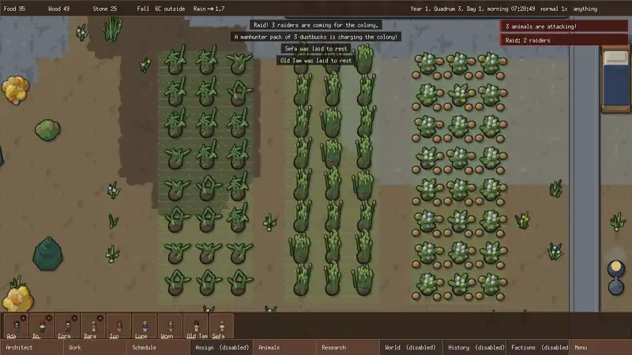
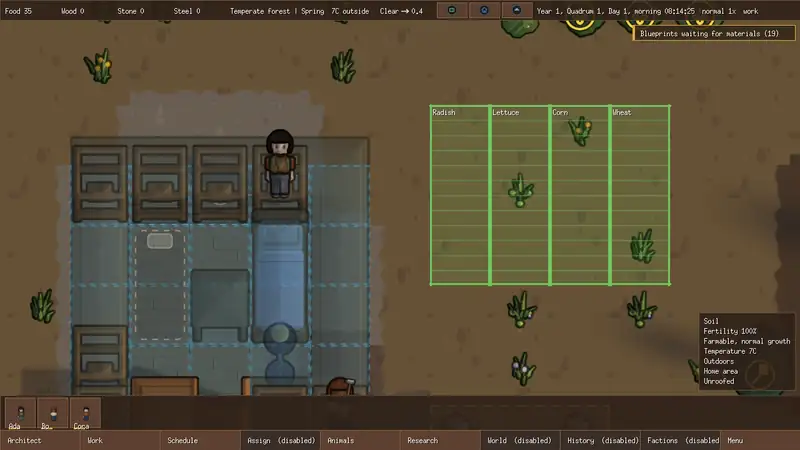
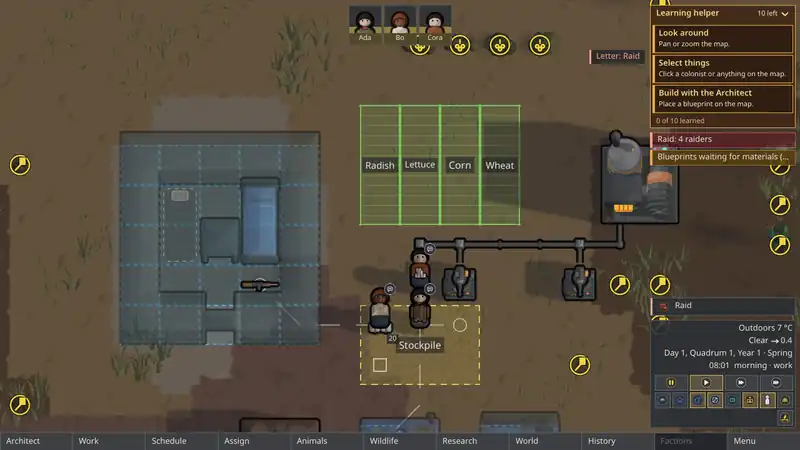
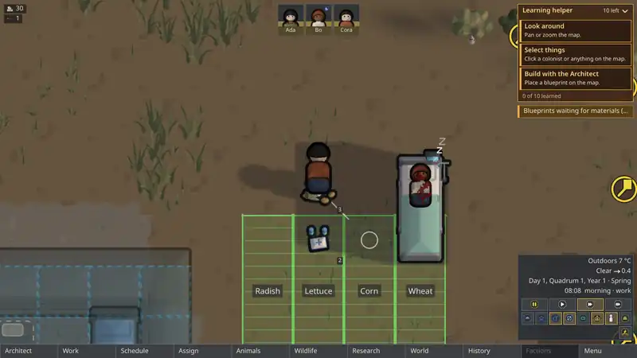
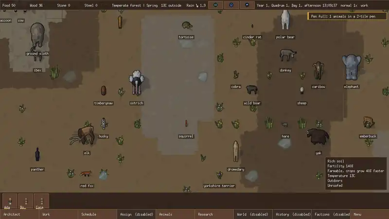
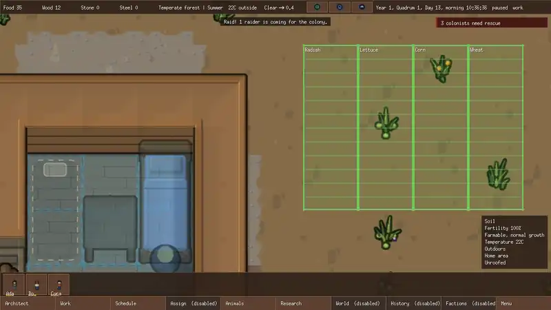
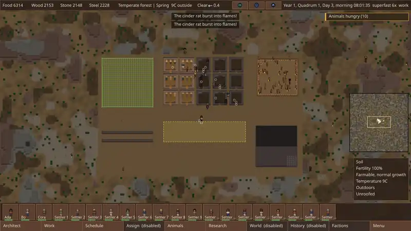

# rimworld-go

**Land on a world you generated. Keep a handful of people alive. See how long it lasts.**

A colony simulation inspired by RimWorld, written in Go with Ebitengine, with all-original Blender-rendered art. No proprietary RimWorld code, art or data.

**[Download for Windows, macOS and Linux](https://github.com/arxdsilva/rimworld-go/releases/latest)**

### One colony, one bad season

- A wolf pack comes in with the first snow, and your only doctor is in bed with the flu.
- You mine into a sealed vault: good loot, a row of sleeper caskets, and hive insects waking in the dark.
- Raiders dig in for a siege while someone carries a bleeding friend to a hospital bed.

## What you do

<table>
  <tr>
    <td width="50%"> 
      <b>Build it.</b> Mine, cut, wall and roof from the Architect menu, and watch haulers feed each blueprint.</td>
    <td width="50%"> 
      <b>Hold the line.</b> Sandbags, spike traps and powered turrets against raids that grow with your wealth.</td>
  </tr>
  <tr>
    <td width="50%"> 
      <b>Patch them up.</b> Wounds bleed by body part, six diseases race immunity, and doctors operate in a hospital bed.</td>
    <td width="50%"> 
      <b>61 animal species.</b> Tame, pen, hunt or flee them: livestock, predators, pets, birds, reptiles and hive insects.</td>
  </tr>
  <tr>
    <td width="50%"> 
      <b>A world that moves.</b> Sun, moon and shadows, seasons, rain and snow, grass that waves in the wind.</td>
    <td width="50%"> 
      <b>Room to grow.</b> Maps up to 500×500 tiles. A grown colony held 117 fps on average (1% low 68) over ten minutes at 3× speed on an Apple M3 Pro,
      at about 0.7 ms per simulation tick.</td>
  </tr>
</table>

More clips and stills are in the [gallery](https://github.com/arxdsilva/rimworld-go/blob/main/docs/GALLERY.md).

## Start playing

1. Download the archive for your system from [Releases](https://github.com/arxdsilva/rimworld-go/releases/latest).
2. Unpack it and keep the `assets` folder next to the `rimworld-go` binary.
3. Run `rimworld-go`. The macOS build is unsigned, so open it the first time with right-click → Open.

You need 64-bit Windows, macOS or Linux, 6 GB of RAM or more (8 GB recommended), and a GPU with Metal, DirectX 11 or OpenGL drivers.
To build from source, install Go 1.26.10 or later (see `go.mod`) and run `go run ./cmd/game`.

## First five minutes

- **Camera:** WASD or arrows pan, the wheel or PgDn / PgUp zoom.
- **Time:** Space pauses, 1 / 2 / 3 set the speed.
- **Select:** click a colonist, Shift+click to add, drag a box.
- **Draft:** R drafts or undrafts, then right-click to give orders.
- **Build:** Tab opens the Architect.

Every key can be changed in Options › Controls.

## Go deeper

- [What works today](https://github.com/arxdsilva/rimworld-go/blob/main/docs/FEATURES.md): the full feature list.
- [Playing](https://github.com/arxdsilva/rimworld-go/blob/main/docs/PLAYING.md): all controls, system requirements, sound and settings.
- [Gallery](https://github.com/arxdsilva/rimworld-go/blob/main/docs/GALLERY.md): every clip and still.
- [Developing](https://github.com/arxdsilva/rimworld-go/blob/main/docs/DEVELOPING.md): build, test, profile, refresh media and sound, release.

## Your data

- Release builds send usage data to the project's website: game start, heartbeat and close, version, OS and CPU, plus random install and launch IDs.
- Options › Gameplay › Share detailed usage data turns off the detailed part (RAM, screen size, graphics quality, colony settings, frame rate).
- Release builds also ask GitHub for the latest release at start, which the switch does not affect. Builds you make yourself send nothing.

Full list of what is and isn't sent: [privacy](https://github.com/arxdsilva/rimworld-go/blob/main/docs/PRIVACY.md).

## Credits and contributing

Normal maps are generated with a Go port of
[spritefusion-sprite-normals](https://github.com/Hugo-Dz/spritefusion-sprite-normals) by Hugo Duprez (MIT); see [`THIRD_PARTY_NOTICES.md`](THIRD_PARTY_NOTICES.md).

Read [`AGENTS.md`](AGENTS.md) before changing code. It sets the rules: hexagonal architecture, and a headless, deterministic domain.
Specs live in [`.cursor/DOCUMENT_INDEX.md`](.cursor/DOCUMENT_INDEX.md), and the art pipeline is documented in [`assets/AGENTS.md`](assets/AGENTS.md).
