# rimworld-go

A RimWorld-inspired colony simulation written in Go with Ebitengine, built in public on YouTube. Original Blender-rendered art; no proprietary RimWorld code, art or data.

<p align="center"></p>

## See it move

<table>
  <tr>
    <td width="50%"><br><sub>The first hut going up from its blueprint</sub></td>
    <td width="50%"><br><sub>A firefight, followed shot by shot</sub></td>
  </tr>
  <tr>
    <td width="50%"><br><sub>Raiders advance on the colony</sub></td>
    <td width="50%"><br><sub>Tamed animals in their pen</sub></td>
  </tr>
  <tr>
    <td width="50%"><br><sub>Knife, spear, club and rifle in a close fight</sub></td>
    <td width="50%"><br><sub>Chopping with a two-handed axe, then on to the next tree</sub></td>
  </tr>
</table>

## Progress

Media updated 2026-10-19 · regenerate with `make screenshots clips`

### Building

<table>
  <tr>
    <td width="50%">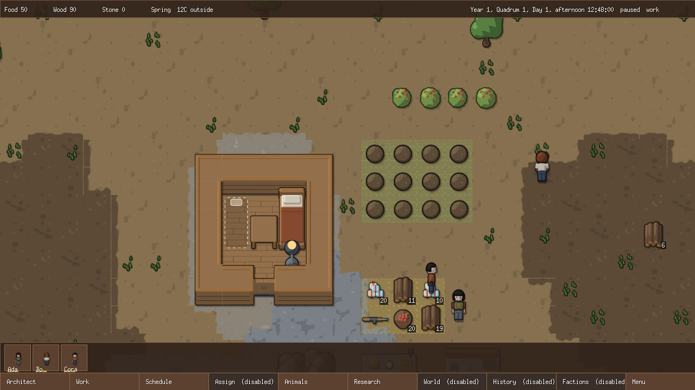<br><sub>A young colony: colonists, a hut, stockpile and wild land</sub></td>
    <td width="50%">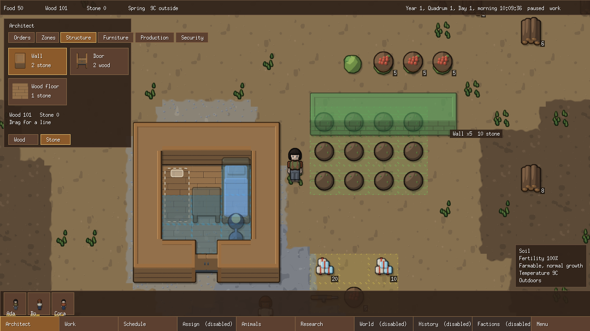<br><sub>Architect menu: placing stone walls</sub></td>
  </tr>
  <tr>
    <td width="50%">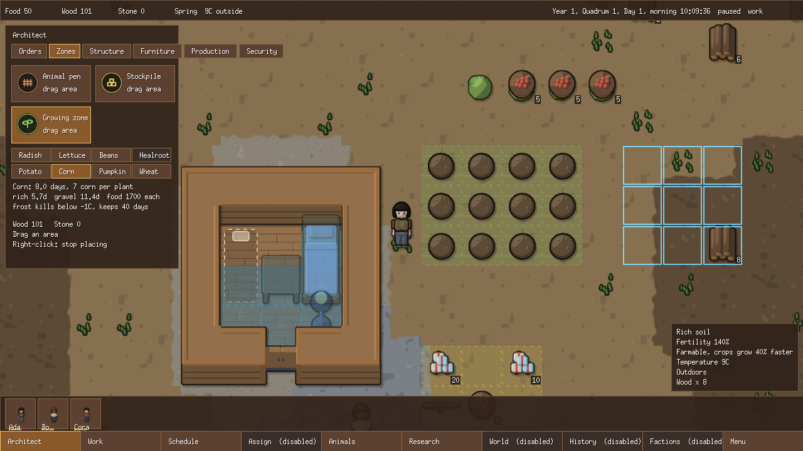<br><sub>Growing zones and the crop picker</sub></td>
    <td width="50%">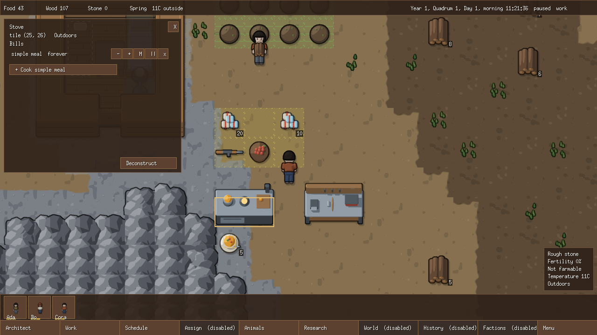<br><sub>Workbenches and production bills</sub></td>
  </tr>
</table>

### Threats

<table>
  <tr>
    <td width="50%">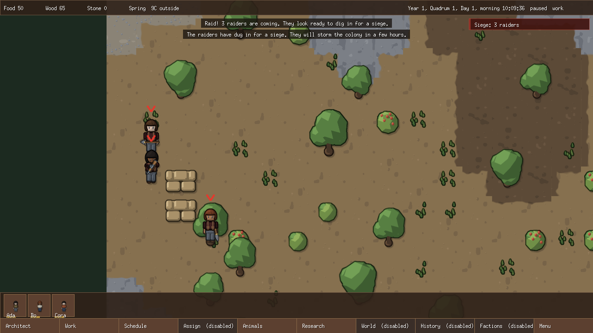<br><sub>Raiders dig in for a siege</sub></td>
    <td width="50%">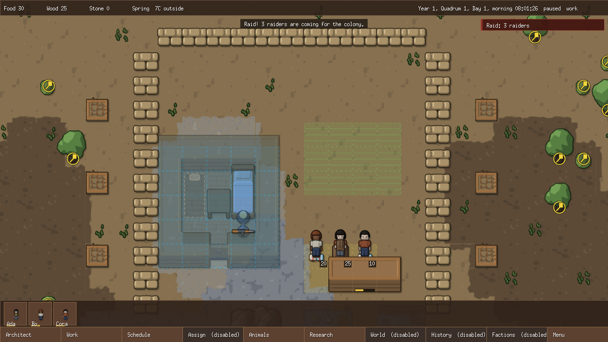<br><sub>A sandbag ring and spike traps as a raid arrives</sub></td>
  </tr>
  <tr>
    <td width="50%">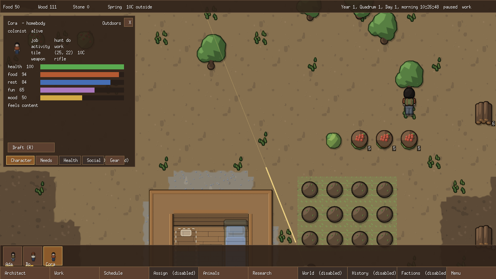<br><sub>A colonist opens fire with a rifle; the inspector shows her needs</sub></td>
    <td width="50%"></td>
  </tr>
</table>

### Colony life

<table>
  <tr>
    <td width="50%">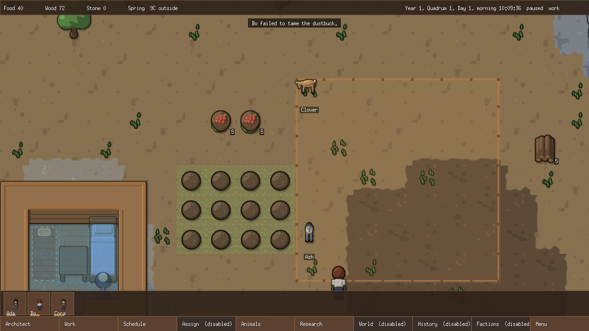<br><sub>A pen of tamed animals; a guard wolf</sub></td>
    <td width="50%">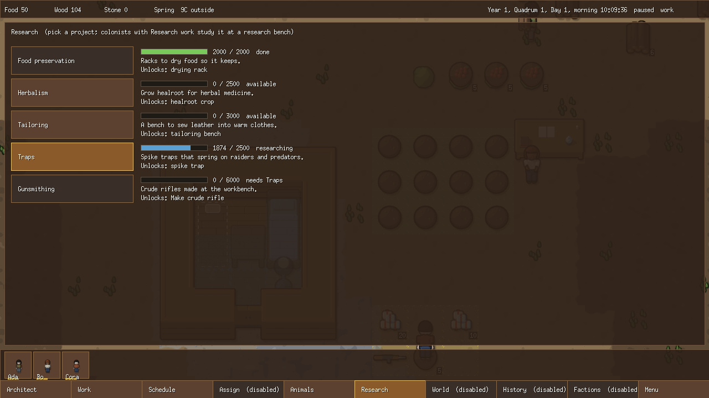<br><sub>Research bench and the project list</sub></td>
  </tr>
  <tr>
    <td width="50%">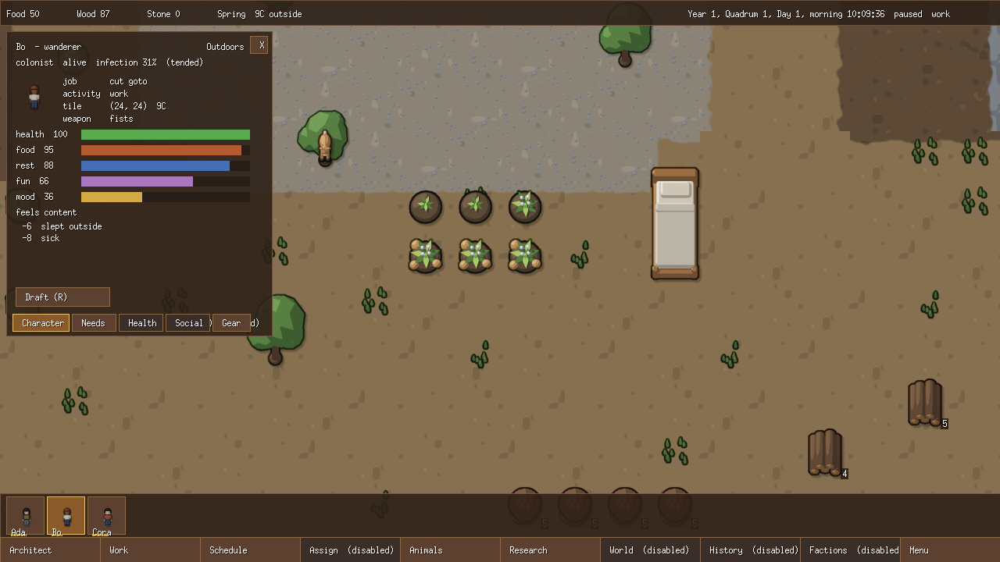<br><sub>A tended infection and a healroot crop at each growth stage</sub></td>
    <td width="50%">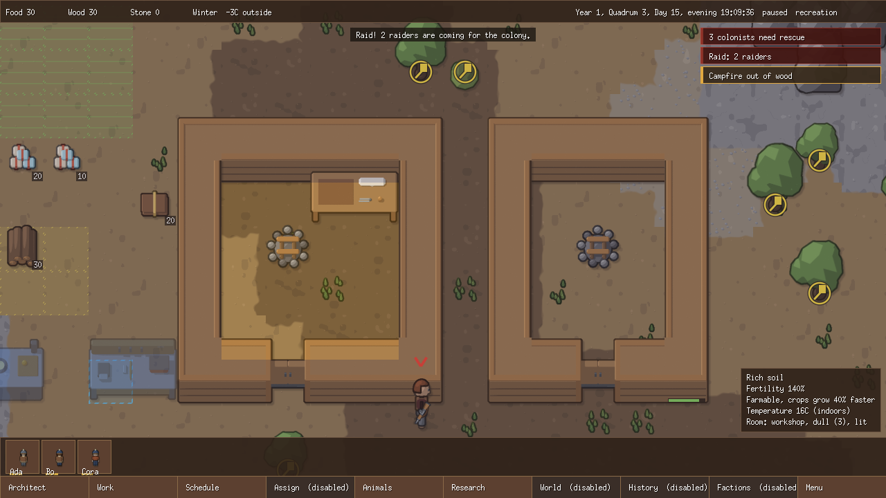<br><sub>Winter night: a heated hut vs a cold one</sub></td>
  </tr>
</table>

## What works today

- Building: generated maps, cutting, mining, walls, doors, beds, multi-tile workbenches and a stove, all placed from the Architect menu.
- Farming and food: growing zones, a crop picker, regrowing berries, campfire cooking, drying racks, spoilage and frost.
- Production: workbench bills, a tailoring bench and clothing (parkas, tuques, dusters).
- Colonists: needs, mood, rooms and impressiveness, recreation, mental breaks, work priorities, schedules and a per-colonist order queue.
- Temperature: seasons, room heat from campfires, and hypothermia on winter nights.
- Threats: raids that scale with colony wealth, sieges, sappers, winter wolf packs, and auto-pause on danger.
- Defences and combat: sandbags, spike traps, breaching raiders, rebuilding after breaches, ranged and melee combat with floating damage numbers.
- Health: injuries, rescue and tending, infections, herbal medicine and a healroot crop.
- Animals: hunting, butchering, taming, pens, guard wolves and manhunters.
- Research: a research bench with five projects that unlock buildings and work.
- Save and load, with a daily autosave.

The full backlogs are in the [vanilla feature checklist](.cursor/RIMWORLD_GO_VANILLA_FEATURE_IMPLEMENTATION_CHECKLIST.md) and the [UI/UX checklist](.cursor/RIMWORLD_GO_UI_UX_IMPLEMENTATION_CHECKLIST.md).

## Run it

Requires Go 1.26.5 or later (the version in [`go.mod`](go.mod)).

```sh
go run ./cmd/game   # start the game
make build          # build every command into bin/
make test           # unit tests with the race detector and coverage
make simulate       # headless simulation run for quick checks
```

### Refreshing the README media

- `make screenshots`: renders the still images through the game's `-capture` flag.
- `make clips`: captures frame sequences and packs them into animated WebP with `scripts/frames_to_webp.py`. Needs python3 and Pillow.

## Project layout & contributing

Read [`AGENTS.md`](AGENTS.md) before changing code. It sets the rules: hexagonal architecture, and a headless, deterministic domain. Specs live in [`.cursor/DOCUMENT_INDEX.md`](.cursor/DOCUMENT_INDEX.md), and the art pipeline is documented in [`assets/AGENTS.md`](assets/AGENTS.md).
